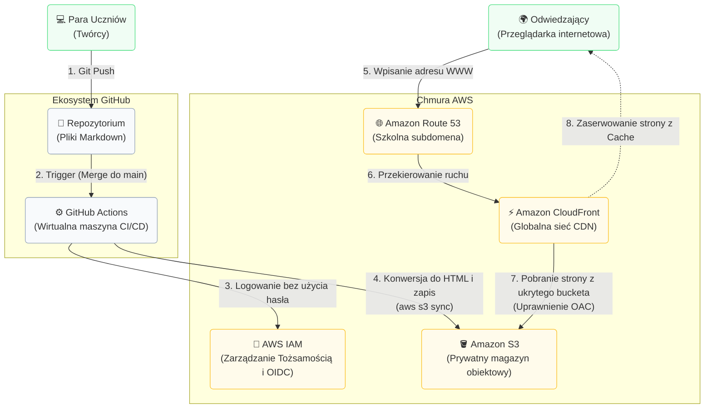
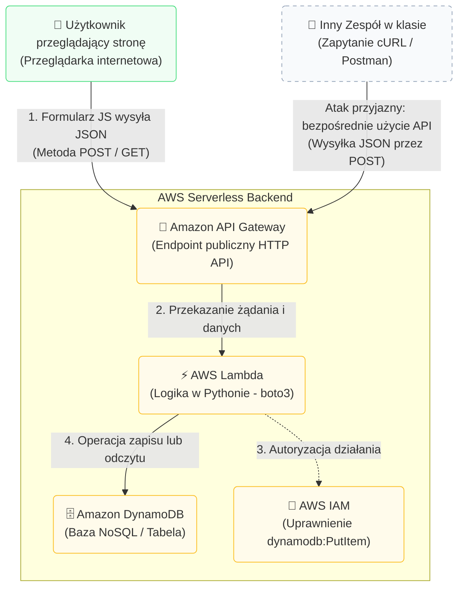

# materialy
    
## Projekt 1: Infrastruktura i CI/CD (Tygodnie 1-5)
### Diagram architektury dla strony www i CI/CD

### Lekcja 1: Inicjalizacja i organizacja pracy (GitHub)

- Wstęp (5 min): Przedstawienie architektury docelowej na tablicy (Użytkownik -> CloudFront -> S3 <- GitHub Actions <- Kod) i podział na pary.
- Praktyka (30 min): Uczniowie logują się na GitHub. Każda para generuje repozytorium z Twojego szablonu (Template). Przechodzą do zakładki "Projects", zakładają tablicę Kanban. Wspólnie dekomponujecie cel "Mamy stronę" na 4 pierwsze zadania (Tickety) i uczniowie przypisują je do siebie.
- Zakończenie (10 min): Zadanie domowe. Zespół ma do następnych zajęć napisać treść swoich wizytówek (pliki .md w folderze docs/), zgłosić Pull Request i go zmergować.

### Lekcja 2: Magazyn danych (S3 i IAM)

- Wstęp (5 min): Koncepcja Object Storage i bezpieczeństwo (dlaczego nie wystawiamy S3 publicznie).
- Praktyka (30 min): Pierwsze logowanie do AWS. Uczniowie tworzą S3 Bucket, odznaczając dostęp publiczny. Następnie wchodzą w IAM i przypisują dostarczoną przez Ciebie gotową politykę Inline (pozwalającą na zapis) do przygotowanej już roli OIDC.
- Zakończenie (10 min): Upewnienie się, że każdy zespół ma ARN swojego bucketu i ARN swojej roli IAM zapisane w notatniku.

### Lekcja 3: Sieć globalna (CloudFront i Route 53)

- Wstęp (10 min): Wyjaśnienie mechanizmu cache'owania (CDN) i delegacji DNS.
- Praktyka (30 min): Wyklikanie dystrybucji CloudFront wskazującej na S3 z włączonym OAC (Origin Access Control). Utworzenie Hosted Zone w Route 53 i skopiowanie 4 rekordów NS.
- Zakończenie (5 min): Pary przekazują Ci (lub nauczycielowi) swoje rekordy NS. Waszym zadaniem jest dodać je do szkolnej domeny głównej do następnego tygodnia.

### Lekcja 4: Automatyzacja wdrażania (GitHub Actions)

- Wstęp (5 min): Po co nam CI/CD? Dlaczego to maszyny mają wdrażać kod.
- Praktyka (30 min): Uczniowie edytują plik .github/workflows/deploy.yml w przeglądarce. Wklejają ARN roli IAM z lekcji 2 i nazwę swojego bucketu. Robią commit do main. Obserwują zakładkę "Actions", jak system buduje z Markdowna HTML i wysyła na S3.
- Zakończenie (10 min): Sprawdzanie efektów. Wpisanie w przeglądarkę swojej szkolnej subdomeny (np. zespol1.szkola.pl). Weryfikacja, czy strona działa.

### Lekcja 5: Pierwsze podsumowanie i Baza Danych

- Wstęp (10 min): Zamykamy Projekt 1 (strony działają). Czas na Projekt 2: Księga Gości. Co to jest baza NoSQL (DynamoDB) i dlaczego jest lepsza do tego celu niż SQL.
- Praktyka (30 min): Wyklikanie tabeli w Amazon DynamoDB (Partition Key = id jako String). Dodanie uprawnień (Inline Policy: dynamodb:PutItem, dynamodb:Scan) do roli, której będzie używać Lambda (znów, role najlepiej przygotuj wcześniej).
- Zakończenie (5 min): Zrozumienie, że na ten moment mamy tylko puste "pudełko" na dane.

## Projekt 2: Serverless i API Economy (Tygodnie 6-10)
### Diagram architektury dla Księgi Gości 

### Lekcja 6: Logika aplikacji (AWS Lambda)

- Wstęp (5 min): Koncepcja Serverless – płacimy tylko za milisekundy wykonania kodu.
- Praktyka (30 min): Utworzenie funkcji AWS Lambda (Python). Uczniowie wklejają Twój gotowy kod. Dodają zmienną środowiskową TABLE_NAME wskazującą na ich tabelę z poprzedniego tygodnia.
- Zakończenie (10 min): Utworzenie testowego eventu bezpośrednio w konsoli AWS Lambda (JSON z fikcyjną wiadomością) i sprawdzenie, czy kod się wykonuje i zwraca 200 OK.

### Lekcja 7: Wystawienie API na świat (API Gateway)

- Wstęp (10 min): REST API, protokół HTTP, metody (GET, POST) oraz problem CORS (dlaczego przeglądarka blokuje nieznane skrypty).
- Praktyka (30 min): Utworzenie API Gateway (HTTP API). Podpięcie funkcji Lambda z poprzedniej lekcji. Konfiguracja i włączenie CORS. Publikacja API (Deploy).
- Zakończenie (5 min): Skopiowanie Invoke URL z API Gateway – to ich adres, z którym będą komunikować się inne zespoły.

### Lekcja 8: Integracja Frontendowa

- Wstęp (5 min): Jak warstwa wizualna rozmawia z backendem.
- Praktyka (30 min): Uczniowie edytują plik ksiega.md na GitHubie. Wklejają gotowy snippet HTML/JS, podmieniając zmienną API_URL na swój Invoke URL z API Gateway. Otwierają Pull Request. Code review między sobą, merge, i oczekiwanie na GitHub Actions.
- Zakończenie (10 min): Testowanie. Pary wchodzą na swoje strony (subdomeny) i próbują dodać wpis z poziomu formularza. Jeśli działa – infrastruktura jest poprawnie spięta.

### Lekcja 9: Współpraca międzyzespołowa (API Economy)

- Wstęp (5 min): Rozdanie kartek/tabeli, w której zespoły wymieniają się swoimi adresami API i linkami do GitHubów.
- Praktyka (35 min): Zespoły atakują API kolegów. Używając skryptu lub Postmana/cURL, wysyłają żądania POST z pozdrowieniami prosto do baz danych innych grup. Następnie wchodzą na GitHuba innej grupy, forkuja repozytorium i robią Pull Request dodający link do ich strony partnerskiej.
- Zakończenie (5 min): Akceptowanie PR od innych grup na żywo (Code Review).

### Lekcja 10: Utrzymanie, Logi i Wielki Finał

- Wstęp (10 min): Co się dzieje, gdy system "leży"? Wprowadzenie do Amazon CloudWatch.
- Praktyka (20 min): Pary otwierają logi swojej Lambdy. Ty celowo (jako prowadzący) wysyłasz do ich API zniekształcony JSON, aby wywołać błąd 500. Ich zadaniem jest znalezienie w logach CloudWatch błędu Pythona i podanie Ci dokładnej godziny jego wystąpienia.
- Zakończenie (15 min): Wzajemna prezentacja projektów na rzutniku. Omówienie, czego się nauczyli o architekturze chmurowej w stosunku do tradycyjnych szkolnych zadań z programowania.
